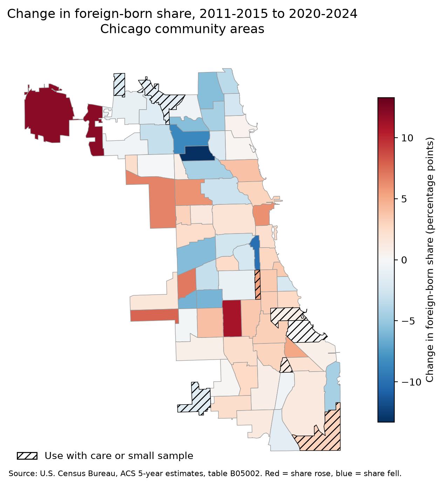
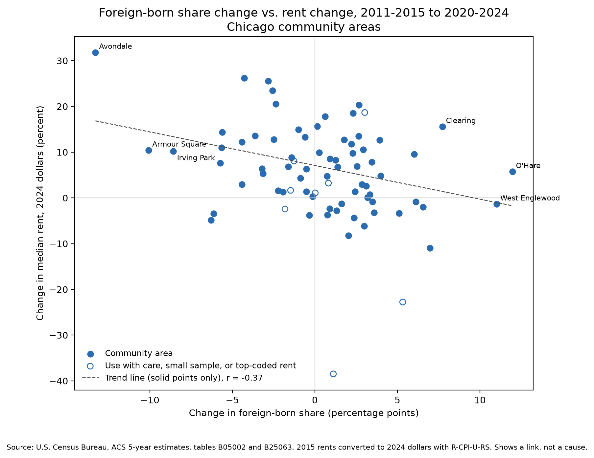

# Who Arrived, and Where Did They Live? Mapping Immigrant Settlement and Housing Pressure in Chicago

**Status:** In progress. Started October 2026. Target completion: November 15, 2026.

## Research Question

How did the change in foreign-born population across Chicago's 77 community areas relate to housing stock and rental market outcomes between 2015 and 2024?

## Progress

- [x] Boundary files and tract files downloaded
- [x] ACS tract data pulled for 2011-2015 and 2020-2024
- [x] Tract-to-community-area crosswalks built and validated
- [x] Community-area tables built for both periods, with rebuilt median rent
- [x] Recent foreign-born arrivals added for both periods (B07007)
- [x] Inflation adjustment (2015 rents to 2024 dollars)
- [x] Cross-check against CMAP for both periods
- [x] Combined 77-row table with change columns
- [x] First map (foreign-born share change) and scatter plot (foreign-born change vs. rent change)
- [x] Findings log with data checks and press sources
- [ ] Margins of error for key counts
- [ ] Remaining maps and charts
- [ ] Write-up

## Early Findings

Full notes, data checks, and press sources: [`notes/findings.md`](notes/findings.md).





- Areas where the foreign-born share fell tended to see larger real rent increases: r = -0.37 across 69 unflagged areas, or -0.28 without Avondale.
- Avondale, Logan Square, and the Lower West Side lost about 11,000 foreign-born residents combined. Real rents there rose 23% to 32%, against a 6.3% city median. Local press names these three areas as the city's top areas for Latino population loss.
- Foreign-born growth was largest in lower-cost areas. West Englewood rose from 2.6% to 13.6% foreign-born. Its 2020-2024 figures match CMAP exactly.
- Recent arrivals from abroad drove the gains in Humboldt Park and O'Hare. Gains in West Englewood and Clearing came mostly from immigrants already living in the U.S.
- These are links, not causes. See Limitations.

## Data Sources

Every reported number comes from the ACS 5-year estimates, calculated the same way for both periods. The one outside input is the price index used to adjust 2015 rents for inflation.

| Measure | Source | Table or file |
|---|---|---|
| Foreign-born share | U.S. Census Bureau, ACS 5-year estimates | B05002 |
| Recent foreign-born arrivals | U.S. Census Bureau, ACS 5-year estimates | B07007 |
| Median gross rent | U.S. Census Bureau, ACS 5-year estimates | B25063 (rent ranges) |
| Rent cost burden | U.S. Census Bureau, ACS 5-year estimates | B25070 |
| Housing units | U.S. Census Bureau, ACS 5-year estimates | B25001 |
| Median rent method check | U.S. Census Bureau, ACS 5-year estimates | B25064 |
| Inflation adjustment | U.S. Bureau of Labor Statistics | R-CPI-U-RS (formerly CPI-U-RS), annual averages |
| Community area boundaries | City of Chicago Data Portal | Boundaries - Community Areas (GeoJSON) |
| Tract boundaries | U.S. Census Bureau, TIGER/Line | 2010 Cook County tracts, 2020 Illinois tracts |
| 2010 to 2020 tract link | U.S. Census Bureau | Tract relationship file |
| Cross-check only | CMAP Community Data Snapshots | Not used as a data source |

Possible later additions, kept separate from the core table: DePaul Institute for Housing Studies displacement data, and Zillow rents through 2026 as a "since 2024" section.

## Methods

1. **Two periods.** ACS 2011-2015 and 2020-2024. The periods do not overlap. 2020-2024 is the newest tract-level release.
2. **Tracts to community areas.** Each period uses its own tract map (2010 tracts for 2011-2015, 2020 tracts for 2020-2024). Each tract is assigned whole to the community area holding the largest share of its land area. Tracts with less than 95% in one area are flagged: 4 of 796 (2010) and 5 of 792 (2020). A tract counts as Chicago if its Census internal point falls inside a community area.
3. **Validation.** Population of the matched 2010 tracts sums to 2,716,981, within about 0.02% of Chicago's 2011-2015 total.
4. **Counts.** Population, foreign-born, housing units, renters, cost-burdened renters, and recent foreign-born arrivals are summed by community area.
5. **Cost burden.** Renters paying 30% or more of income on rent, divided by renters for whom burden is computed.
6. **Median rent.** Medians cannot be added. Each community area's median is rebuilt from rent-range counts (B25063) by linear interpolation within the range holding the middle renter. The rent ranges are identical in both periods. Applied to single tracts, the method reproduces Census-published tract medians to within $1 in nearly all cases.
7. **Recent arrivals.** Foreign-born people who moved from abroad in the past year (B07007_028E), divided by population age 1 and over (B07007_001E). The total moved from abroad (B07007_026E) is not used because it includes U.S.-born people returning home. Variable codes and meanings are identical in both periods.
8. **Inflation adjustment.** 2011-2015 rents are in 2015 dollars. 2020-2024 rents are in 2024 dollars. 2015 rents are converted to 2024 dollars by multiplying by the ratio of the 2024 to the 2015 annual average of the R-CPI-U-RS, published by the Bureau of Labor Statistics. This is the index the Census Bureau recommends for comparing ACS dollar values, and the one it uses to build them. The 2015 annual average is 348.300 and the 2024 annual average is 462.511, a factor of 1.327910. The factor is computed by `scripts/inflation_factor.py` and saved in `data/processed/inflation_factor.json`.
9. **Cross-check.** Both tables are checked against the CMAP Community Data Snapshots, downloaded by hand from the CMAP Data Hub: the June 2026 release (ACS 2020-2024) and the 2017 release (ACS 2011-2015). CMAP is a check only, not a data source. All 77 areas match by name in both. City totals are within 0.03% in both periods. 90% of areas are within 0.66% on each count, and within 0.09% on median rent for 2020-2024. The 2017 release has no foreign-born or median rent columns, so 2011-2015 is checked on population and housing units only. Woodlawn runs 10% to 14% high and South Shore about 5% low in both periods. Woodlawn holds tract 17031843900, which is only 89% inside Woodlawn and is assigned whole to it, while CMAP splits it. Because the gap appears in both periods, it affects levels more than change. Fuller Park differs by up to 8.8% on foreign-born in 2020-2024 because it is very small. Use these three areas with care.
10. **Combined table and change.** The two periods are joined into one 77-row table (`data/processed/ca_combined.csv`). Counts change in number and percent. Shares change in percentage points. Real rent change compares 2024 median rent to 2015 median rent in 2024 dollars. Percent change is left blank where the 2015 value is zero (8 areas with zero recent arrivals in both periods). Two flags travel with the data: `use_with_care` marks Woodlawn, South Shore, and Fuller Park (see Methods 9), and `small_sample` marks areas with fewer than 1,000 renter households in either period: Burnside, Edison Park, Forest Glen, Fuller Park, Hegewisch, and Mount Greenwood. Their rent and cost-burden figures rest on few survey responses and can swing widely. For example, Burnside shows a 38.5% real rent drop on about 450 renter households. These areas are kept, not dropped, so the map has no gaps.
11. **Visuals.** The map shows change in foreign-born share in percentage points, on a color scale centered at zero. Areas flagged `use_with_care` or `small_sample` are hatched. The scatter plot compares change in foreign-born share with percent change in real median rent. Points are hollow for flagged areas and for areas with top-coded rent in either period. The trend line and correlation (r) use solid points only. The correlation was also checked without Avondale, the largest outlier.

## How to Reproduce

1. Install Python 3 and the packages: `pip install -r requirements.txt`
2. Get a free Census API key at https://api.census.gov/data/key_signup.html. Copy `.env.example` to `.env` in the project root and set `CENSUS_API_KEY=your-key`. The `.env` file is ignored by git, so the key stays out of the repo.
3. Run the scripts in order:
   - `python scripts/pull_acs.py`
   - `python scripts/pull_rent_ranges.py`
   - `python scripts/pull_recent_arrivals.py`
   - `python scripts/build_crosswalk.py`
   - `python scripts/build_ca_tables.py`
   - `python scripts/inflation_factor.py`
   - `python scripts/build_combined.py`
   - `python scripts/cross_check_cmap.py` (check only; needs `data/raw/cmap_cds_2026_cca.csv` and `data/raw/cmap_cds_2017_cca.csv`, downloaded by hand)
   - `python scripts/make_map.py`
   - `python scripts/make_scatter.py`

Boundary and tract files are already in `data/raw`. So is the BLS inflation file (`data/raw/r-cpi-u-rs-allitems.xlsx`). BLS blocks scripted downloads, so it was downloaded by hand from https://www.bls.gov/cpi/research-series/r-cpi-u-rs-home.htm.

## Limitations

- **Correlation, not causation.** This project describes relationships at the community-area level. It does not show that immigration caused any housing outcome.
- **Area-level data only.** Patterns across community areas may not apply to individual households.
- **Survey error.** ACS figures are estimates with margins of error. Smaller community areas have wider margins. Interpolated medians do not have exact margins.
- **Foreign-born is not the same as recent arrivals.** The foreign-born measure includes people who arrived decades ago. The recent-arrivals measure covers only the past year and rests on small counts, so its margins of error are wide. Some community areas show zero.
- **Foreign-born is not the same as Latino.** Press coverage of displacement usually counts Latino residents, many of whom are U.S.-born. People born in Puerto Rico count as native-born in the ACS, so their moves do not show up in the foreign-born measure.
- **Pooled years.** Each 5-year estimate covers five years of surveys. 2020-2024 centers on about 2022 and only partly reflects the 2022 to 2024 migrant arrivals.
- **Recent arrivals likely undercounted in 2020-2024.** The period includes 2020 and 2021, when international travel was low. Migrants housed in shelters from 2022 on may also be undercounted.
- **Inflation index.** The R-CPI-U-RS is a national, all-items index. It does not reflect Chicago prices or housing costs on their own. "Real" rent change means rent change compared to overall U.S. prices.
- **Whole-tract assignment.** Tracts that cross community-area lines are assigned to one area, not split.
- **Pandemic effects.** ACS data collection was disrupted in 2020, which affects part of the later period.

## Repository Structure

```text
data/
  raw/          Original downloads, unedited
  processed/    Crosswalks and community-area tables
scripts/        Download, processing, and chart code
outputs/        Maps and charts
notes/          Findings log and press sources
```

Raw and processed data are kept separate so every result can be reproduced from the original downloads.
